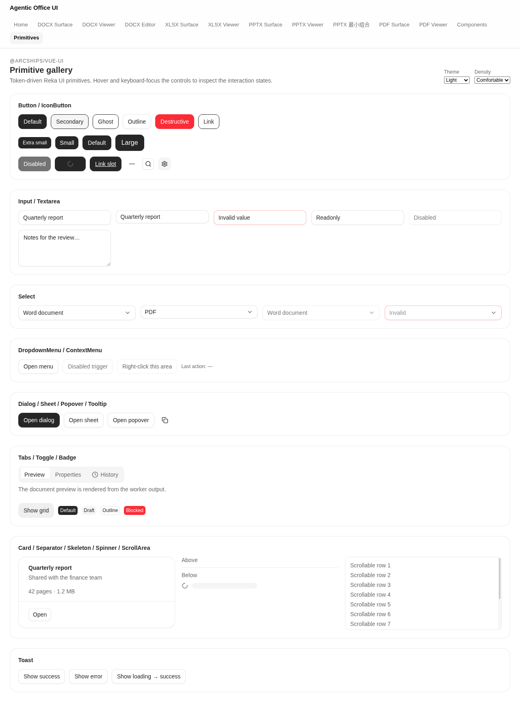
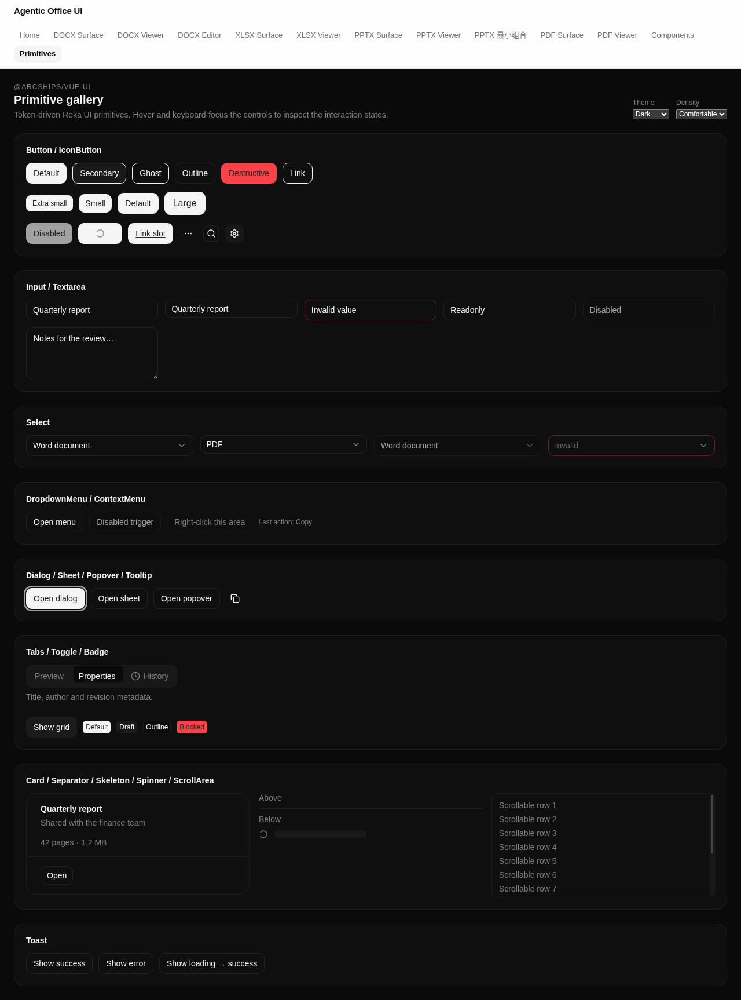
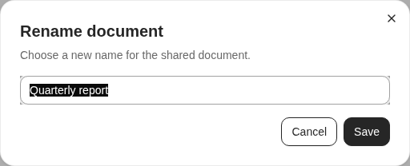
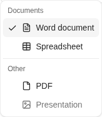
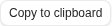
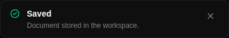

# Vue primitive 层（reka-ui，无 Tailwind）

> 状态：已实现（issue #157）。运行时基于 `reka-ui@^2.11`，视觉全部来自
> `--office-*` token；不引入 Tailwind、preflight 或 `class-variance-authority`。
>
> 参考：Extend UI / shadcn `apps/v4/registry/new-york-v4/ui`，固定 commit
> `70fe70c6f1e1eee53954c6923f3d9f583557a57e`；交互语义来自
> [reka-ui](https://github.com/unovue/reka-ui)。

## 1. 安装与主题

```bash
pnpm add @arcships/vue-ui reka-ui
```

```ts
// main.ts
import "@arcships/vue-ui/style.css"
import "@arcships/vue-ui/theme.css"
```

Primitive 的颜色、圆角、字号、阴影和控件高度全部读取 `--office-*` token。使用前必须有一个
`[data-office-theme]` 祖先；推荐直接使用 `OfficeThemeProvider`：

```vue
<script setup lang="ts">
import { ref } from "vue"
import { OfficeButton, OfficeThemeProvider } from "@arcships/vue-ui"

const theme = ref<"light" | "dark" | "system">("system")
</script>

<template>
  <OfficeThemeProvider :theme="theme">
    <OfficeButton>保存</OfficeButton>
  </OfficeThemeProvider>
</template>
```

没有 Provider 时，宿主可以在任意祖先元素写 `data-office-theme="light"` 或 `dark`。不引入
`style.css` 时组件没有样式；不引入 `theme.css`/`tokens.css` 时语义颜色为空。

## 2. 公共 API 约定

所有 primitive 共享以下约定：

| 约定 | 说明 |
|---|---|
| `class` | 合并到最有意义的 DOM 根（`OfficeSelect` 合并到 trigger，`OfficeDialog`/`OfficeSheet` 合并到面板，菜单合并到 content）。 |
| `variant` | `default` / `secondary` / `ghost` / `outline` / `destructive` / `link`。Button、IconButton、Badge、Toggle 支持；菜单项另有 `default` / `destructive`。 |
| `size` | 文本控件：`xs` / `sm` / `default` / `lg`；Button 另有 `icon` / `icon-sm` / `icon-lg`。 |
| `disabled` | 原生 `disabled` 与 `aria-disabled`；Reka 根组件使用 `data-disabled`。 |
| `loading` | Button/IconButton 居中显示 `OfficeSpinner`，保留宽度，写 `data-loading="true"`、`aria-busy="true"` 并禁用激活。 |
| `data-slot` | 每个可渲染部分都有稳定的 `data-slot`，用于样式钩子和测试，不依赖 `data-v-*` 哈希。 |
| `asChild` | Button、IconButton、Badge、Separator、Skeleton、Toggle 支持 slot 形式；Dialog/Sheet/Menu/Popover/Tooltip 的 `trigger`/默认 slot 本身就是 asChild。 |

`asChild` 只接受**单个**根元素。`OfficeButton` 在 `asChild` 模式不会插入 loading spinner（spinner 会破坏单根约束），但仍会写 `data-loading` 和 `aria-busy`；需要 spinner 时使用非 asChild 形式。

### 2.1 尺寸与触控

| 尺寸 | 高度 token | comfortable | compact |
|---|---|---|---|
| `xs` | `--office-control-height-xs` | 1.75rem / 28px | 1.5rem / 24px |
| `sm` | `--office-control-height-sm` | 2rem / 32px | 1.75rem / 28px |
| `default` | `--office-control-height` | 2.25rem / 36px | 2rem / 32px |
| `lg` | `--office-control-height` + spacing(1) | 2.5rem / 40px | 2.25rem / 36px |

`icon` 为 32px 方形，`icon-sm` 为 28px，`icon-lg` 为 40px。`@media (pointer: coarse)` 下按钮、
图标按钮、菜单项、Select 项、Tabs trigger 和 Toggle 提供至少 44px（`--office-ui-touch-target`）
的命中区。

## 3. Primitive 一览

### 3.1 Button / IconButton

```vue
<OfficeButton variant="default" size="sm" :loading="saving" @click="save">
  保存
</OfficeButton>

<OfficeIconButton label="更多操作" icon="more-horizontal" active />
<OfficeIconButton label="搜索" icon="search" variant="outline" size="icon-sm" />
```

| Prop | 类型 | 默认 |
|---|---|---|
| `variant` | `OfficeVariant` | `default` |
| `size` | `OfficeButtonSize` | `default` |
| `disabled` / `loading` | `boolean` | `false` |
| `asChild` | `boolean` | `false` |
| `type` | `button` / `submit` / `reset` | `button` |

`OfficeIconButton` 额外要求 `label`（可访问名称），并支持 `icon`、`title`、`active`；`active`
输出 `data-active="true"` 与 `aria-pressed="true"`。

### 3.2 Input / Textarea

```vue
<OfficeInput v-model="title" size="sm" placeholder="文档标题" />
<OfficeInput :model-value="bad" invalid />
<OfficeTextarea v-model="notes" :rows="4" />
```

支持 `modelValue` / `update:modelValue`、`size`、`invalid`（写 `aria-invalid="true"`）、
`disabled`、`readonly`、`placeholder`、`type`。Textarea 的 `rows` 只是初始值，CSS 仍保证
`2.5 ×` 控件高度的最小高度。

### 3.3 Select

```vue
<script setup lang="ts">
import { ref } from "vue"
import type { OfficeSelectEntry } from "@arcships/vue-ui"

const format = ref("docx")
const options: OfficeSelectEntry[] = [
  { type: "group", label: "文档", options: [
    { value: "docx", label: "Word", icon: "file-text" },
    { value: "xlsx", label: "Excel", icon: "table" },
  ]},
  { type: "separator" },
  { value: "pdf", label: "PDF", icon: "file" },
]
</script>

<template>
  <OfficeSelect v-model="format" :options="options" placeholder="选择格式" />
</template>
```

| Prop | 类型 | 默认 |
|---|---|---|
| `modelValue` | `string` | — |
| `options` | `OfficeSelectEntry[]` | 必填 |
| `placeholder` | `string` | — |
| `size` | `OfficeControlSize` | `default` |
| `disabled` / `invalid` / `required` | `boolean` | `false` |
| `ariaLabel` | `string` | — |
| `name` / `id` | `string` | — |
| `side` / `align` / `sideOffset` | `OfficeSide` / `OfficeAlign` / `number` | `bottom` / `start` / `4` |

事件：`update:modelValue`、`update:open`。内容始终 portal 到 `body`，Reka 负责碰撞翻转、键盘
选择（Enter/Space 打开，方向键移动，Enter 确认，Esc 关闭）和 `role=combobox/listbox/option`。

### 3.4 DropdownMenu / ContextMenu

两个菜单共用同一套 `OfficeMenuEntry` 描述符：

```ts
type OfficeMenuEntry =
  | { type?: "item"; id?; label; icon?; shortcut?; disabled?; variant?; onSelect? }
  | { type: "checkbox"; id?; label; checked; icon?; shortcut?; disabled?; onSelect? }
  | { type: "separator"; id? }
  | { type: "label"; label; id? }
  | { type: "group"; label?; id?; items: OfficeMenuEntry[] }
  | { type: "sub"; label; icon?; id?; disabled?; items: OfficeMenuEntry[] }
```

```vue
<OfficeDropdownMenu
  :items="items"
  label="打开菜单"
  @select="handleSelect"
/>

<OfficeContextMenu :items="items" @select="handleSelect">
  <div class="canvas">右键点击</div>
</OfficeContextMenu>
```

Dropdown 还支持 `open`（`v-model:open`）、`triggerVariant`、`triggerSize`、`disabled`、
`side`、`align`、`sideOffset`、`alignOffset` 和 `#trigger` slot。ContextMenu 的默认 slot 是
右键区域（单根）。事件：`select(entry, event)`、`update:open`。

复选框项是受控的：点击会触发 `select`，但不会改变你的 `items` 数据；宿主在 `select` 中更新
`checked`。Reka 负责高亮、typeahead、方向键循环、子菜单和 `role=menu/menuitem`。

### 3.5 Dialog / Sheet

```vue
<OfficeDialog
  v-model:open="open"
  title="重命名文档"
  description="为共享文档选择一个新名称。"
>
  <template #trigger><OfficeButton>打开</OfficeButton></template>
  <OfficeInput v-model="name" aria-label="文档名称" />
  <template #footer>
    <OfficeButton variant="ghost" @click="open = false">取消</OfficeButton>
    <OfficeButton @click="save">保存</OfficeButton>
  </template>
</OfficeDialog>

<OfficeSheet v-model:open="sheetOpen" title="文档详情" side="right">
  <template #trigger><OfficeButton>打开面板</OfficeButton></template>
  面板内容
</OfficeSheet>
```

| Prop | 类型 | 默认 |
|---|---|---|
| `open` | `boolean` | — |
| `title` / `description` | `string` | `title` 回退到本地化“对话框” |
| `size`（Dialog） | `sm` / `default` / `lg` / `xl` / `full` | `default` |
| `side`（Sheet） | `top` / `right` / `bottom` / `left` | `right` |
| `showClose` | `boolean` | `true` |
| `titleHidden` | `boolean` | `false` |
| `modal` | `boolean` | `true` |
| `closeOnEscape` / `closeOnBackdrop` | `boolean` | `true` |
| `closeLabel` | `string` | 本地化“关闭” |

Slot：`trigger`、`title`、`description`、`header`、默认内容、`footer`。行为直接来自 Reka：
焦点移入面板、Tab/Shift+Tab 焦点陷阱、Esc 关闭、点击 backdrop 关闭、关闭后焦点回到 trigger。
`title` 为空时仍会渲染本地化标题；没有 `description` 时会渲染仅供读屏的说明，避免缺少
`aria-describedby`。

### 3.6 Popover / Tooltip

```vue
<OfficePopover v-model:open="open" label="打开浮层" side="bottom" align="center">
  浮层内容
</OfficePopover>

<OfficeTooltip content="复制到剪贴板" side="top">
  <OfficeIconButton label="复制" icon="copy" />
</OfficeTooltip>
```

Popover 支持 `#trigger`、`label`、`triggerVariant`、`triggerSize`、`side`、`align`、
`sideOffset`、`alignOffset`、`modal` 和 `v-model:open`。Tooltip 支持 `content`、`#content`、
`side`、`align`、`sideOffset`、`delayDuration`（默认 300ms）和 `disabled`；悬浮或聚焦后显示，
失焦/Esc 隐藏，并通过 `aria-describedby` 关联 trigger。

旧的 `Tooltip` 组件保留原 props（`content`、`side`、`align`、`delayMs`、`className`），内部
改为委托 `OfficeTooltip`，因此同样获得碰撞定位和 Reka 的键盘/焦点语义。

### 3.7 Tabs

```vue
<OfficeTabs v-model="tab" :tabs="tabs" variant="default">
  <template #panel-preview>预览内容</template>
  <template #panel-properties>属性内容</template>
</OfficeTabs>
```

`tabs: OfficeTab[]` 为 `{ value, label, icon?, disabled? }`；面板 slot 名为
`panel-<value>`。支持 `variant: "default" | "underline"`、`orientation:
"horizontal" | "vertical"`、`class`、`contentClass` 与 `update:modelValue`。
Reka 提供 `role=tablist/tab/tabpanel`、`aria-selected`、roving tabindex、方向键和 Enter/Space。

### 3.8 Toggle

```vue
<OfficeToggle v-model="pressed" label="显示网格">显示网格</OfficeToggle>
```

支持 `variant: "default" | "outline"`、`size`、`disabled`、`label`、`asChild`。受控
`modelValue`，输出 `aria-pressed` 与 `data-state="on|off"`。

### 3.9 Badge / Card / Separator / Skeleton / Spinner / ScrollArea

```vue
<OfficeBadge variant="secondary">Draft</OfficeBadge>

<OfficeCard title="季度报告" description="财务团队共享">
  42 页 · 1.2 MB
  <template #footer><OfficeButton size="sm" variant="outline">打开</OfficeButton></template>
</OfficeCard>

<OfficeSeparator />
<OfficeSkeleton class="line" />
<OfficeSpinner label="正在加载" />
<OfficeScrollArea orientation="both" class="scroll">
  <div class="content">…</div>
</OfficeScrollArea>
```

- `OfficeBadge`：`variant`、`size`、`asChild`。
- `OfficeCard`：`title`、`description`、`headingLevel`、`class`；slot `header`、默认内容、`footer`。
- `OfficeSeparator`：`orientation`、`decorative`、`asChild`；装饰分隔符输出 `role="none"`。
- `OfficeSkeleton`：`aria-hidden="true"`，带 reduced-motion 保护。
- `OfficeSpinner`：`size`、`label`（传 `null` 为装饰性）、`class`；`role=status`，旋转来自
  `OfficeIcon` 的 `loader-circle`。旧 `Spinner` 保留 `className`，并接受 `size`。
- `OfficeScrollArea`：`orientation`、`type`、`scrollHideDelay`、`class`、`viewportClass`；
  viewport 可聚焦，滚动条使用 Reka 的 `ScrollArea`。

### 3.10 Toast

```vue
<script setup lang="ts">
import { useOfficeToast } from "@arcships/vue-ui"
const toast = useOfficeToast()
toast.success("已保存", "文档已写入工作区。")
const id = toast.loading("正在导出", "渲染页面…")
toast.update(id, { title: "导出完成", status: "success" })
</script>

<template>
  <OfficeToastProvider position="bottom-right">
    <App />
  </OfficeToastProvider>
</template>
```

`OfficeToastProvider` props：`duration`（5000）、`limit`、`label`、`closeLabel`、`position`
（四角）、`disableSwipe`。`useOfficeToast()` 返回 `add`、`close`、`update`、`promise`、
`success`、`error`、`warning`、`info`、`loading`、`dismiss`；在 Provider 外调用会抛出明确错误。
Toast 使用 `role=status`/`aria-live`、`data-status` 着色、Esc/关闭按钮和 swipe-to-dismiss。

## 4. 视觉与 token 规则

- 颜色、圆角、字号、阴影、控件高度只使用 `tokens.css` 的 `--office-*` 变量。
- 共享 token 没有覆盖的间距、overlay、z-index、动画时长声明在 `.office-ui` 上，作为
  primitive 局部 token；组件规则仍然不写裸 hex、裸 `rgb()`、裸圆角或裸 `font-size`。
- 不使用 Tailwind/preflight，不修改 `:root`/`html`/`body`，不引入全局 reset。
- 深色/浅色由 `[data-office-theme]` 决定；组件不依赖 `.dark` 类。
- `prefers-reduced-motion: reduce` 下关闭 spinner、骨架和浮层动画。
- 样式入口：`@arcships/vue-ui/style.css`（包含 primitive 规则）；主题入口：
  `@arcships/vue-ui/theme.css`。
- Portal：token 只声明在 `[data-office-theme]` 子树内，而 Teleport 默认去 `body`。`OfficeThemeProvider`
  因此在主题子树内渲染一个 `display: contents` 的 portal host，并通过内部注入让
  Dialog/Sheet/Select/Menu/Popover/Tooltip/Toast 使用它；没有 Provider 时回退到 `body`
  （适合宿主自己在 `body` 上写 `data-office-theme`）。这样浮层不会丢失 token。

静态合同由 `tests/unit/vue-ui-primitives-contract.test.mjs` 守护，包括 token 使用、无
Tailwind、variant/size 完整性和 bundle 预算。

## 5. 可访问性与交互清单

| 交互 | 实现 |
|---|---|
| 焦点环 | `:focus-visible` 使用 `--office-ring-width` + `--office-ring`；不覆盖浏览器对非键盘焦点的判断 |
| 键盘 | Enter/Space、方向键、Home/End、Esc、Tab/Shift+Tab 由 Reka 原语提供；Dialog/Sheet 焦点陷阱、关闭后焦点归还 |
| ARIA | Dialog 标题/描述关联、Select combobox/listbox、Tabs tablist/tabpanel、菜单 menu/menuitem、Toast status、Spinner `role=status` |
| Portal | Dialog、Sheet、Select、Menu、Popover、Tooltip、Toast 均 portal 到 `body` |
| 碰撞 | Reka/Floating UI 负责 flip/shift；`side`、`align`、`sideOffset` 可配置 |
| 禁用 | 原生 `disabled`（表单/按钮）或 `data-disabled`（Reka 项）；`pointer-events: none` + `opacity` |
| 加载 | `loading` 保留标签宽度、显示 spinner、写 `aria-busy` 并阻止重复提交 |
| 触控 | `(pointer: coarse)` 下 44px 命中区；Dialog 在窄屏底部吸附 |
| 本地化 | 关闭、加载、通知、对话框等通用标签按 Office locale 返回中/英；业务文案由宿主传入 |

## 6. 测试与包体积

运行时测试：`tests/component/vue-ui-primitives.test.mjs`（happy-dom + 真实 DOM）覆盖每个
primitive 的挂载、Button/Input/Select/Menu/Dialog/Sheet/Popover/Tooltip/Tabs/Toggle/Toast
的键盘/ARIA/焦点陷阱/禁用/加载，以及全部 primitive 的 SSR 渲染。

```bash
pnpm --filter @arcships/vue-ui build
node --test --test-concurrency=1 tests/component/vue-ui-primitives.test.mjs
node --test --test-concurrency=1 tests/unit/vue-ui-primitives-contract.test.mjs
```

包体积预算：`scripts/ci/vue-ui-primitives-size-budget.json` 记录合并基线（Vite 报告
`15.60 kB` JS + `3.54 kB` CSS gzip）和 `35 KB` 新增预算。构建产物实测（gzip level 9）：

| 文件 | 构建后 | gzip |
|---|---|---|
| `dist/index.js` | 104,152 B | 22,554 B |
| `dist/style.css` | 47,450 B | 7,547 B |
| 合计 | | 30,101 B |
| 相对基线新增 | | 10,961 B |

`reka-ui`、`@lucide/vue`、`vue` 在库构建中保持 external；图标不进入本包产物，仍由
`OfficeIcon` 的内置注册表或宿主按需提供。预算测试同时断言 `dist/index.js` 不内联
`reka-ui`/Floating UI 源码。

## 7. Extend / shadcn 视觉对照状态

本轮没有可运行的 #155 像素对比 harness（`/tmp/b08-155/scripts/ci/pixel-parity.mjs` 与
`pnpm ui:parity` 在该 worktree 中不存在）。因此：

- 已按 Extend `registry/new-york-v4/ui` 的 class 清单逐项映射尺寸、圆角、间距、颜色层级、
  focus ring、disabled/loading 和菜单高亮；
- demo 新增 `/primitives` gallery，包含 default/hover/focus/disabled/loading 状态和固定
  `data-testid`；`scripts/ci/capture-primitives-gallery.py` 通过 Playwright 生成确定性元素
  截图（1280×960、DPR 1、light/dark、无 console error），本轮证据在
  `output/parity/`（Button/Input/Select content/Dialog/Tooltip/Toast 及整页）；
- Button/Input/Select/Dialog/Tooltip 的像素 diff **尚未**由 #155 harness 验证，不能声明
  `≤0.1%` 通过；#155 落地后应使用其 baseline 重新测量并记录实际 delta。

本轮固定状态截图（light/dark、1280×960、DPR 1）：

| 状态 | 截图 |
|---|---|
| 整页 light |  |
| 整页 dark |  |
| Dialog light |  |
| Select 选项层 |  |
| Tooltip |  |
| Toast success（dark） |  |

## 8. 兼容性

- 现有 `Spinner`、`Tooltip` 的公开 props 保留；`Tooltip` 的内部实现改为 `OfficeTooltip`。
- 现有 `OfficeThemeProvider`、`OfficeIcon`、选择原语、上传/签名/Find Bar 等组件不变。
- `@arcships/vue-ui` 主入口新增 `Office*` 导出；`reka-ui` 只作为运行时依赖，不要求宿主
  安装 Tailwind 或任何 CSS 框架。
